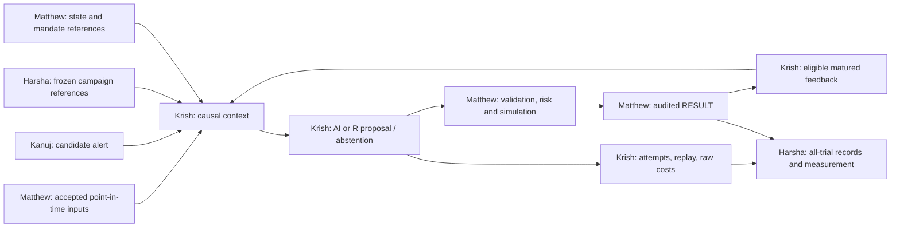

# Research contract and implementation handoff

## Start here: authority before action

This is the canonical Krish producer specification for CONTEXT/CANDIDATE,
attempts, model replay and raw cost receipts, produced under
[#375](https://github.com/KanujVerma/drift/issues/375). **It is a draft contract
proposal until independent acceptance and merge. It implements no runtime.**
The proposed wire profile below is `drift-research/1-draft`; that name is not an
existing Python type or an accepted persisted schema. Replace the draft profile
only through the recorded acceptance decision, then pin the accepted commit in
each runtime child issue. A merged document alone is not permission to run a study.

A fresh Antigravity agent using its available Flash model should do the following:

1. Read [AGENTS.md](../../../../AGENTS.md),
   [onboarding](../onboarding.md), [D01-D17](../decisions.md),
   [design](../design.md), [workstreams](../../workstreams.md),
   [crosswalk](../requirements-crosswalk.md) and
   [Resume/Checkpoint/Handoff](../../agent-workflow.md). Run Resume. Verify the
   actual repo, branch, HEAD, authenticated GitHub actor, writer and exact issue
   write-set. Do not stash, reset or clean another checkout.
2. Read the assigned issue, latest comments, blockers, draft PR, independent
   reviews and the exact accepted producer contracts. Select an executable
   READY issue. #373 is a parent; #375 is design only. Neither authorizes code.
3. Explain the owned slice, inputs, output, acceptance cases and stop conditions
   from this package. Claim and read back the issue before edits. If only #375
   is assigned, edit only this file and keep its PR draft.
4. For later runtime, choose one accepted child slice from the dependency order
   below. Copy its exact path reservation and tests into that child's issue,
   obtain the required producer/consumer decisions, then acquire the paths.
   A proposed path below is not a present write grant.
5. Deliver one reviewable PR, exact-head evidence and a GitHub Checkpoint/Handoff.
   Do not merge, self-certify a shared interface or silently choose a missing
   material parameter. Use the decision packets below and continue independent
   work when a particular dependency is blocked.

The coding model available in Antigravity and the future runtime research model
are separate facts. No Flash version, context size, tool capability, API access,
pricing, quota or subscription entitlement is assumed. Record actual capability
only when verified in the authorized environment. No runtime LLM call, provider
credential, paid service, dataset acquisition, broker-connected paper operation
or live capital is authorized here.

Navigate: [mission and ownership](#mission-accepted-choices-and-boundaries),
[current implementation](#flow-and-current-implementation-truth),
[wire rules](#proposed-common-wire-rules), [CONTEXT](#context-contract),
[CANDIDATE](#candidate-validation-and-action-semantics),
[receipts/replay](#attempts-replay-and-raw-spending-receipts),
[fixtures](#concrete-fixture-package),
[future slices](#dependency-ordered-future-implementation-slices),
[decisions and immediate work](#decision-packets-and-stop-routing).

### Precedence and source manifest

The source baseline is remote main
[`54708219563ada3e8b115b609a522dec694bc274`](https://github.com/KanujVerma/drift/commit/54708219563ada3e8b115b609a522dec694bc274),
the merge of [#385](https://github.com/KanujVerma/drift/pull/385). This was read
from a fresh isolated Mac checkout of GitHub main. It contains no asserted
unpushed work from another machine. This manifest records source provenance,
not a live status mirror; refresh GitHub on Resume and at shared-boundary edits.

| Source at that baseline, unless a different ref is given | Authority / use |
|---|---|
| `AGENTS.md`; `.cursor/rules/drift-bootstrap.mdc`; `.cursor/commands/resume.md` | Universal operating contract; Cursor files are wrappers. No `.agents/` directory exists at this baseline. |
| `docs/architecture/workstreams.md`; `docs/adr/0015-three-feature-workstreams-and-explicit-writer-handoffs.md` | Four owners and incumbent writer protection; takes precedence over stale owner allocations. |
| `docs/architecture/adaptive-experiments/{onboarding,decisions,design,requirements-crosswalk,delivery-plan}.md`; ADR 0016 | Accepted intent, rationale and sequencing; D01-D17 remain intact. |
| `docs/architecture/{agent-workflow,roadmap,overview,trust-boundaries}.md`; ADR 0012 | Workflow, historical milestones, evidence and operational limits. Roadmap/overview historical completion language is not adaptive completion or operational permission. |
| `src/drift/domain/{common,artifacts,strategies,research_agent,research_memory,research_loop,evaluator_strategy,evaluator_protocol,evaluator_portfolio,evaluator_results}.py` | Existing types and invariants, not the proposed adaptive wire profile. |
| `src/drift/agent/{protocol,context,validator,runner,gemini_agent}.py`; `src/drift/memory/archive.py`; `src/drift/loop/{runner,evaluator_adapter,diagnosis}.py` | Existing M6-M8 behavior and gaps below. |
| `src/drift/baselines/`; `src/drift/evaluator/{engine,experiment_runner}.py`; `src/drift/serialization/canonical.py` | Reuse the one evaluator, immutable controls and existing canonical serialization. |
| `src/drift/scorecards/{generator,multiple_testing}.py` | Scientific-consumption audit anchors only; #382/#377 own measurement acceptance and repairs. |
| [#388 activation receipt](https://github.com/KanujVerma/drift/issues/388#issuecomment-6146943823); #386 | Completed activation evidence for this design entry; not provider/runtime permission. |
| [#375](https://github.com/KanujVerma/drift/issues/375), [#392](https://github.com/KanujVerma/drift/issues/392), [#394](https://github.com/KanujVerma/drift/issues/394), [#376](https://github.com/KanujVerma/drift/issues/376), [#379](https://github.com/KanujVerma/drift/issues/379), [#380](https://github.com/KanujVerma/drift/issues/380) | Live issue authority and exact producer scopes. Accepted revisions must be named before runtime consumption. |
| [#350](https://github.com/KanujVerma/drift/pull/350), inspected head `7bd838013635d7be344d4c45cbfdaa01be34fc0c` | Incumbent draft research integrity / M2 bridge / parallel portfolios, not main. |
| [#367](https://github.com/KanujVerma/drift/pull/367), inspected head `f1904a08ba345a959da656c8836b7a6b2e911d2d` | Incumbent draft historical benchmark, source/dividend/evaluator changes, not main; based on #350. |

The old #373 title and objective assign experiment design, cost accounting,
statistics and scientific eligibility broadly to Krish. The merged four-owner
policy and the narrower #375/#392 scopes govern. Do not implement from stale
#373 prose. [#399](https://github.com/KanujVerma/drift/issues/399) owns that
metadata correction. [#371](https://github.com/KanujVerma/drift/issues/371)
owns existing writer/legacy-document reconciliation. This file does not modify
those records or create a duplicate completion ledger.

## Mission, accepted choices and boundaries

Build a bounded intelligence and learning producer whose recommendations can
be measured fairly against controls. Profitability is an empirical objective,
never a guarantee or an implementation acceptance assertion. Correct,
reproducible evidence can show loss, no advantage or an inconclusive comparison.

Architecture **MVP-BOUNDED** (historical architecture Option B, D01) chooses
approved families, approved parameters and allocations. **FUTURE-GENERATED**
(historical architecture Option C) may later propose code through a separately
accepted sandbox and eligibility process. Neither label means portfolio B or C.
Portfolio **B** is adaptive AI; **C** is the passive benchmark. **B0-B5** are
deterministic baseline identities and are a third, separate naming system.

| Owner | Producer responsibility | Boundary this contract respects |
|---|---|---|
| Krish | Causal context, significance analysis, bounded proposals, permitted inner learning, optimizer R, model replay and raw attempt/spending receipts | Cannot define scientific success, amend a mandate, rewrite audited account results or execute generated code. |
| Matthew | SRC, portfolio/account state, RESULT, EXEC, MANDATE/APPROVAL; data, timing, one simulator/account ledger, risk and operational enforcement | Research consumes his accepted objects. It cannot invent fills, source rights, eligibility enforcement or approval state. |
| Harsha | EXPERIMENT/ELIGIBILITY, frozen study/campaign and arm identity, orchestration, canonical all-trial record, cost attribution, metrics, uncertainty and reports | This document supplies receipts and consumption requirements only. It defines no experiment or eligibility wire schema, thresholds or canonical trial ledger. |
| Kanuj (Krish's brother) | Small deterministic offline TRIAGE behavior/output in #393 and runtime #381 after its contracts | Supplies review alerts, not trades, LLM significance decisions, ingestion or mandatory global reviews. |

Matthew independently reviews this producer contract for consumption. Harsha
reviews attempt/cost/feedback compatibility with #392; his review does not
replace Matthew's required acceptance. Krish reviews research consumption of
Matthew/Harsha producer contracts. Author review, agreement between agents,
passing tests and automated CI are not independent shared-contract acceptance.

Accepted D01-D17 imply the following behavior, with unresolved parameters
remaining explicit configuration gates:

- D02/D03/D09: market inputs first, news first-class, lightweight screening then
  deeper significance analysis. Credibility, novelty, sentiment and investment
  relevance are distinct. An alert asks for review; it cannot grant an order.
- D04: weekly routine review, monthly planned family/parameter updates and event
  review are separate clocks. Existing approved strategy rules may trade at their
  allowed cadence. A review need not trade or change a family. Exact schedules,
  cooldowns, timezone/calendar rules and proposal TTL require acceptance.
- D05/D06: full event response and separately named defensive-only comparison;
  regular/pre-market/after-hours simulated execution only through an accepted
  versioned capability extension. Next-session execution is an explicit comparison
  or declared fallback. Daily bars do not establish intraday fills; overnight is
  deferred. Research never supplies a retrospective attractive fill price.
- D07/D08/D10: expected net return within a versioned mandate; Conservative,
  Balanced, Aggressive and Advanced are profiles of one risk engine. Roughly
  10-15 diversified liquid ETFs are intent, not an approved list. No shorting,
  leverage, options or crypto. Numerical risk/spread/turnover limits are unresolved.
- D11/D12/D13: development/validation/untouched holdout/prospective evidence;
  matched information and news ablations; same-pool selection, matched-opportunity
  search and flexible capped economic studies. Harsha freezes study semantics.
- D14/D15: learning method fixed, eligible state evolving. Envelope-compliant
  reactions differ from a new/materially changed strategy, which must obtain
  stage-specific eligibility. A proposer cannot label itself eligible.
- D16/D17: preregistered evidence quantity/duration, uncertainty and review
  schedule; measurable approval modes with mandatory safeguards. Scientific
  eligibility, risk acceptance, simulation approval and live permission differ.

Each of A/B/C/D/R is a separate USD 10,000 simulated account, not pooled capital.
A is a frozen policy that can execute its fixed rules; B adapts; C is ordinary
passive buy-and-hold, initially intended as SPY if genuinely supported; D is
cash with declared yield/fee/inflation assumptions; R is conventional non-LLM
optimization. A risk-matched passive variant needs a different identity. Shared
LLM-derived signals and their costs must be disclosed when R consumes them.
Five accounts and four human owners do not activate M9 runtime teams. #16 stays
conditional; ten agents are not a requirement.

### Flow and current implementation truth



| Existing anchor at baseline | What exists | Adaptive gap / required treatment |
|---|---|---|
| `ResearchContextPacketV1`, `ResearchContextSynthesizer.synthesize_packet` | Hash-checked research summaries; `as_of_time` stamps packet creation | Archive count/distributions/postmortems are unfiltered global reads. No arm/campaign/matured-outcome cutoff. A timestamp label does not prove causality. |
| `ExperimentSpecificationProposalV1` | Strategy string, parameters/hash, nonblank `universe_id`, `rebalance_frequency`, creation/hash | No approved registry/envelope, state/mandate identity, weights/cash or decision lifetime. Strings do not resolve a revision or clock. |
| `ProposalValidator.validate_proposal`, `ParameterSearchSpaceV1` | Parameter-name coverage, global dedup, lineage and fixed falsification checks | Does not establish typed numeric ranges, approved-family authorization or causal dedup. Existing string matching and Sharpe/drawdown/turnover constants are not accepted adaptive thresholds. |
| `ResearchAgentProtocol.generate_proposal`, `ResearchAgentRunner.run_cycle` | Returns hypothesis/experiment tuples; optional hypothesis registration | No new CONTEXT/CANDIDATE protocol, per-attempt receipts or authoritative mandate binding. Model-proposed falsification criteria cannot become campaign success criteria. |
| `GeminiResearchAgent` | Injected callback/client, JSON parsing and a model-name default | Existing `gemini-2.5-flash`, universe and weekly defaults are historical behavior, not verified Antigravity capability or adaptive choices. Request/response replay, resolved model revision and raw spend are absent. |
| `ResearchMemoryArchive` / M6 records | Append-only event-backed trials and queries | No causal per-arm projection. Distribution reads `sharpe_ratio`; M8 supplies `annualized_sharpe`. Map from accepted metric definitions or refuse ambiguity, never substitute zero. |
| `ResearchLoopRunner.run` / main diagnosis | Recursive proposal/evaluation loop; synthetic 60-second iteration and 30-second completion offsets; missing metric defaults | Not a causal portfolio scheduler or measured latency. Missing mandatory metrics default to zero in main; optional IC can be skipped despite a stated criterion. Bounded producer issues must address these discrepancies. |
| Main `TrialEvaluatorProtocol` / `DeterministicMockTrialEvaluator` | Metric mapping protocol and deterministic mock metrics | Mock/hash-derived metrics prove fixtures only. They are not investment performance or Matthew RESULT. |
| #350 exact inspected draft | `M2TrialEvaluatorAdapter`, `ExecutionConfigurationV2`, baseline mapping, mock isolation, mandatory-metric refusal, invalidated-versus-falsified handling | Reuse only after independently accepted exact revision and documented writer release/merge. Do not duplicate this M2 bridge. It still lacks state binding, per-arm causal memory, replay and spending receipts. |
| M2 `StrategyDecisionContextV1`, `StrategyDecisionIntentV1`, `SessionEvaluatorEngine.run` | Session-close causal context; long-only whole-share targets; bound run identity; regular post-close/next-open protocol | Allocation weights need Matthew's accepted conversion policy. No intraday upgrade, new schema or executor rewrite is implied. |
| B0-B5 library | B0 cash, B1 single-security buy-and-hold, B2 equal-weight buy-and-hold, B3 monthly equal-weight rebalance, B4 momentum, B5 low volatility | Freeze controls. Current agent default strings do not consistently identify those controls. A tunable variant gets its own identity and envelope. |

Protected #350 surfaces include `agent/context.py`, `agent/validator.py`,
`loop/{diagnosis,evaluator_adapter,runner}.py`, parallel portfolios, related
tests, `README.md`, roadmap/overview and its audit document. #367 also reserves
parallel portfolios, provider/source/dividend/evaluator paths and tests. On any
future issue, refresh full changed-file lists and claims. Neither age nor a
green check releases a file. Additive proposed modules below do not authorize
editing exports, schemas, scripts or integration tests outside that issue.

## Proposed common wire rules

All field tables are complete for this draft profile; fields are required
unless explicitly nullable or optional. Required nullable fields must be present
as `null`, with their paired reason/state. Unknown fields, duplicate JSON keys,
wrong types, non-finite values and unknown profile/enum versions are refused.
Do not coerce a boolean to an integer, a string to a quantity, or a JSON float
to an exact amount. Raw malformed bytes can still be retained in a receipt.

| Term | Exact proposed representation / rule |
|---|---|
| `Id` | Newly issued research record IDs are RFC 9562 UUIDv7 strings. External campaign/arm/account IDs are opaque nonblank strings; never infer their semantics from a prefix. |
| `Digest` | 64 lowercase hexadecimal SHA-256 characters. Digests bind bytes/content, not source origin, approval or economic truth. |
| `Time` | UTC ISO timestamp `YYYY-MM-DDTHH:MM:SS.ffffffZ`, six fractional digits; compare instants. Local scheduling uses a separately versioned IANA-zone/calendar policy. No naive timestamps or wall-clock substitution. |
| `DecimalText` | Finite base-10 string, no exponent, leading plus, leading zero except `0`, negative zero or trailing fractional zeros. Examples: `"0"`, `"0.6"`, `"10000"`. Negative permitted only when explicitly declared. No rounding/coercion. |
| Money | Nonnegative `DecimalText` with explicit currency and cost/valuation basis. Provider-native raw billing text is retained in the raw artifact even when it needs conversion. No implicit FX. |
| Weight | `DecimalText` fraction of investable NAV in [0,1], never percent text. No approximate float sum. |
| Counts / durations | Strict JSON integers, counts >= 0; measured durations in milliseconds >= 0, nullable when unknown with reason. Session counts are not calendar days. |
| `Ref` | Research-side binding wrapper `{ "id": Id-or-external-Id, "version": nonblank-string, "sha256": Digest }`. Resolves to one immutable authorized object. It does not redefine that producer's object schema or claim the object exists. External mappings are an acceptance dependency. |
| `Scope` | `{experiment_id, arm_id, account_id, campaign_ref}`. All external IDs must belong together under Harsha/Matthew accepted references. Equality is exact on all four values; this defines no experiment schema. |
| `ArtifactRef` | Existing `ArtifactReference` semantics: UUIDv7 `artifact_id`, existing `kind`, `content_hash`, retained `location`. No new location grants, credentials, URL fetch or object-kind expansion. A retained location is inert and access-controlled. |

Use `src/drift/serialization/canonical.py` semantics for canonical record bytes:
UTF-8, sorted string keys, compact separators, `ensure_ascii=False`, finite JSON.
Canonicalize declared decimals/times before hashing. Each record has `record_hash`,
the canonical content hash of all its other fields; exclude only its own
`record_hash`. Parameter hash binds the exact canonical parameters object. Raw
request/response hashes bind exact bytes, separately from parsed record hashes.
Do not edit the M0/M1 serializer or existing replay hashes. External producer
hashes retain their own accepted preimage rules; do not recompute them as a
research record. Reference/version/hash mismatches refuse dependent use.

Arrays are ordered: targets by security UUID bytes; evidence/memory entries by
`available_at` then ref ID/version/hash; raw receipt IDs by UUID bytes. Duplicate
members are invalid. Model message order, retrieval rank and stream chunks are
semantically ordered and must retain their original order in replay artifacts.
The accepted wire-version/decimal policy is decision packet DP-R1, not settled
merely by this proposal.

## CONTEXT contract

Input to a producer is one immutable context plus its resolved authorized
dependencies. The trusted context builder verifies dependencies and records
exclusions. Models receive a projection of verified values and inert text;
they cannot substitute references, clocks, policy, budgets or permissions.

| Field | Type / semantics |
|---|---|
| `profile`, `kind` | Literal `drift-research/1-draft`, `context`. |
| `context_id`, `scope`, `record_hash` | `Id`, `Scope`, `Digest`. |
| `decision_cutoff` | `Time`: latest admitted information instant, fixed before review. |
| `built_at`, `review_started_at` | `Time`: `decision_cutoff <= built_at <= review_started_at`. These are actual/declared simulation clock facts, not inferred synthetic latency. |
| `review_reason` | `routine`, `event`, `strategy_rule` or `scheduled_adaptation`. Event requires an accepted `trigger_ref`; other modes have `trigger_ref=null`. |
| `trigger_ref` | Nullable `Ref` to TRIAGE/review trigger. A trigger cannot authorize trade. |
| `clock_policy_ref`, `method_ref`, `budget_ref` | `Ref` to accepted timing, frozen learning method and producer spending reservation policy. No method/budget definitions from model output. |
| `portfolio_ref`, `mandate_ref`, `universe_ref`, `registry_ref` | `Ref` to Matthew state/mandate/universe and accepted approved-family registry. Exact consumer mapping needs acceptance. |
| `current_selection_ref` | Nullable Ref to the trusted current approved selection in Krish's policy state. Hold requires this to resolve and match; absent/unknown current selection cannot be inferred from holdings. |
| `memory_snapshot_ref`, `memory_cutoff` | `Ref`, `Time <= decision_cutoff`. Snapshot contains only allowed scope and matured knowledge available at that cutoff. |
| `inputs` | Array of `InputBinding` below; may be empty only when accepted policy permits that input condition. Empty is not healthy-feed evidence. |
| `excluded_inputs_ref` | `Ref` to inclusion/exclusion manifest with reasons; includes unavailable, future, rights-denied and revision-conflict candidates. |
| `feed_state_ref`, `feedback_refs` | `Ref` to Matthew coverage/health evidence; ordered array of accepted matured RESULT/feedback refs. Feed state is not guessed here. |
| `source_grade`, `limitations` | Literal `synthetic_fixture`, `exploratory` or `qualified`; nonblank reason strings array. Grade must match dependencies. `qualified` requires accepted qualification evidence; never upgraded by a proposer. |

`InputBinding` has exactly `input_ref: Ref`, `role: "market"|"news"|"filing"|
"authorized_social"|"derived_signal"`, `available_at: Time`,
`availability_basis_ref: Ref`, and `transformation_ref: Ref|null`.
Publication, update, first-received times, source/security identity, rights,
quality and revision relations live in Matthew's SRC object, not a second source
envelope here. #394 is the only minimal triage envelope. #376 owns broader SRC
and RESULT. Derived inputs require transformation identity and causal upstream
refs. Their completion time is included in availability evidence.

Context construction must enforce the following, with no implicit favorable
default for missing dependencies:

1. Resolve campaign/arm/account, frozen method, accepted registry, mandate,
   universe and complete reconciled portfolio state at the admitted cutoff.
   State includes positions, cash, claims, pending intents/orders and relevant
   risk/reconciliation state under Matthew's contract. Read-only projections
   cannot hide a pending order. Missing/unknown state makes context unavailable
   for a risk-taking proposal; descriptive research may proceed only if its
   accepted issue explicitly permits that degraded mode.
2. Every admitted source version must have known, accepted availability basis
   at or before `decision_cutoff`. Publication alone is insufficient. Actual
   receipt/retrieval/transformation availability constrains usable knowledge.
   A later historical fetch cannot be described as the system's earlier receipt.
   Historical availability claims require their own evidence and limitations.
3. A correction first available after the cutoff stays excluded even if its
   publication/effective date is earlier. Do not overwrite historical versions.
   Later context can admit the corrected version; conflicts remain explicit.
   Exact duplicate versus correction is governed by SRC/TRIAGE, not fuzzy text
   resemblance or sentiment. Broken/unknown feed differs from confirmed empty.
4. Enforce accepted information-sharing rules. Market source bytes can be shared
   read-only; private learned state, results, pending orders and research history
   cannot leak across arms. Approved common initialization/shared signals must
   be identified in the campaign references. Aggregate holdout evaluation/report
   outputs stay sealed from tuning. Whether preregistered B may consume lagged
   per-arm outcomes during an adaptive holdout is unresolved DP-R8; until its
   accepted rule exists, do not admit that feedback or claim such a campaign is
   a pristine confirmation. A producer cannot choose the exposure policy.
5. Every feedback entry includes outcome completion, validation/availability
   instant, RESULT completeness and origin scope through its accepted producer
   object. `outcome_end <= feedback_available_at <= memory_cutoff`. An economic
   timestamp without actual availability cannot mature feedback. Invalid or
   incomplete simulation can teach an engineering refusal but cannot falsify an
   investment hypothesis. Undefined/missing statistics stay unavailable.
6. Snapshot counts, summaries, dedup and negative knowledge are derived only
   from that same admitted view. A global ledger count can reveal future/cross-arm
   trials even without full records. Audit exclusions and holdout access history.

Model training/pretraining can contain later historical outcomes despite correct
prompt cutoffs. Record known/unknown model training horizon as a limitation.
Hiding tickers, a causal prompt, deterministic replay or declaring 2025 a holdout
does not prove an untouched test. D11's intended 2021-2023/2024/2025 roles remain
conditional on supported data and actual access history. Do not weaken evidence
floors or relabel contaminated/unverifiable data. Prospective evidence and
independent scientific review remain necessary before advantage claims.

## CANDIDATE, validation and action semantics

The raw producer output is untrusted. A trusted validator binds context and
configuration, checks exact schema and approved envelopes, then records a
validation receipt. `propose` means a recommendation awaiting Matthew's risk,
approval and execution checks; it does not mean accepted order, fill or eligibility.

### Raw choice versus trusted normalized candidate

A model, R selector or scripted producer emits the proposed **RawChoice** JSON
projection below. It does not issue IDs, timestamps, policy/approval/reference
wrappers, costs or normalized hashes. Every field is required, extra/duplicate
keys are invalid, and the common strict decimal/integer rules apply:

| RawChoice field | Proposed exact type / rule |
|---|---|
| `disposition` | propose, hold, abstain or unavailable. |
| `selection` | `{family_id: nonblank-string, strategy_version: nonblank-string, parameters: object}` for propose/hold; null for abstain/unavailable. Hold must match the resolved current selection. |
| `targets`, `cash_weight` | TargetWeight array and Weight for propose; empty array and null otherwise. |
| `evidence_ids` | Ordered distinct external/ref ID strings from the admitted context projection; validator resolves exact permitted versions/hashes. Unknown/ambiguous IDs reject. |
| `rationale`, `reason_codes` | Nonblank plain text and distinct nonblank strings; reasons required for abstain/unavailable. |

Proposed trusted invocation binding has required `attempt_id`, `candidate_id`,
`validation_id` (Id), `policy_ref` (Ref), `raw_output_ref` (already retained
ArtifactRef), `producer` (producer enum), `completed_at`, `checked_at` (Time),
`valid_until` (clock-derived nullable Time), `model_replay_ref` (nullable Ref),
`cost_receipt_ids` (ordered Id array). Trusted normalization copies scope/context/
state/mandate/method bindings, resolves the allowed selection to exact registry/
envelope/eligibility refs, calculates parameter/record hashes and maps admitted
evidence IDs. It rejects any claimed binding outside the accepted context;
current selection comes from `current_selection_ref`, not an inference from
positions. The binding uses actual retained call/parser completion evidence.

A malformed output still yields a validation receipt from trusted invocation
identity and the retained raw artifact. The pure validator cannot write storage
or invent an ArtifactRef; caller retention occurs first under accepted rights.
Missing retention can produce a preflight/error attempt with limitation and no
normal validation receipt requiring those bytes. If a future method deliberately
accepts complete normalized candidate JSON as input, it must separately specify
and revalidate every trusted binding; do not silently accept it as RawChoice.

| Field | Type / semantics |
|---|---|
| `profile`, `kind` | Literals `drift-research/1-draft`, `candidate`. |
| `candidate_id`, `attempt_id`, `scope`, `record_hash` | `Id`, `Id`, `Scope`, `Digest`; exact context/attempt scope. |
| `context_ref` | `Ref` binding the context ID/profile/hash. |
| `portfolio_ref`, `mandate_ref`, `universe_ref`, `registry_ref`, `method_ref` | `Ref`, exact matches to context. Cannot be model-selected replacements. |
| `producer` | Literal `ai`, `conventional_r` or `scripted_fixture`. |
| `completed_at`, `valid_until` | `Time`, `Time\|null`. Completion >= review start. `propose`/`hold` need accepted clock-derived expiry strictly after completion. Nullable for abstain/unavailable; no guessed TTL. |
| `disposition` | `propose`, `hold`, `abstain` or `unavailable`. Rules below. |
| `strategy` | `ApprovedSelection\|null`, defined below. Required for propose/hold. |
| `targets`, `cash_weight` | Ordered `TargetWeight[]`, `Weight\|null`. Always present; populated only for propose, otherwise [] and null. |
| `evidence_refs`, `rationale`, `reason_codes` | Ordered admitted `Ref[]`, nonblank plain text, distinct nonblank code strings. Reasons nonempty for abstain/unavailable. Evidence grounding is checked against admitted refs, not invented URLs. |
| `model_replay_ref` | `Ref\|null`: required for AI output, null for R/scripted. An AI receipt can describe failure; a failed call supplies no tradeable candidate. |
| `cost_receipt_ids` | Ordered `Id[]` referencing raw incurred producer cost receipts, possibly empty only with a documented no-work basis. No promise of zero actual cost. |

`ApprovedSelection` has exactly `family_id: nonblank-string`,
`strategy_ref: Ref`, `envelope_ref: Ref`, `parameters: object`,
`parameters_hash: Digest`, `eligibility_ref: Ref`. The registry entry binds
approved family/strategy identity, implementation artifact/code identity,
version, envelope, admissible universe/actions and stage-specific eligibility.
The research wrapper does not define Harsha's eligibility object. Resolve and
verify the authoritative evidence, never trust a model-supplied approval flag.

Each envelope parameter is typed, has units, admissible values/ranges and exact
boundary inclusivity, with required keys and cross-parameter constraints. A
registry/envelope must be accepted before use; `dimension_names` is insufficient.
Unknown keys, wrong units/type, out-of-range values, missing constraints and
arbitrary code/import/tool fragments reject. Frozen B0-B5 parameters/identities
are not edited; tunable variants receive separate reviewed identities. A changed
family, code, envelope or action outside approval becomes a new candidate under
D15 and waits for eligibility. Research may record it as rejected/proposed
future research, never route it to execution.

`TargetWeight` has exactly `security_id: UUIDv7`, `weight: Weight`. For propose,
the security list must cover the union of the admitted investable universe and
currently held securities, once each, with explicit zero targets where needed.
Targets outside the investable universe can only be zero for a currently held
security; disposal legality and tradability remain Matthew checks. Weights plus
cash equal exactly one. No negative weights, leverage or shorts. Claims and
reserved cash are not silently investable cash. Portfolio NAV/valuation and
weight-to-whole-share conversion are Matthew's policy, with residual cash,
fees, pending orders and price freshness. This wire profile specifies allocation
intent, never quantity rounding or a second ledger.

| Disposition / validator outcome | Exact meaning |
|---|---|
| `propose` | Approved selection, complete targets and cash weight; dependent accepted timing, state, eligibility, budget and mandate checks required. May recommend increase, reduce or reallocate within accepted actions. |
| `hold` | Intentionally retain the context-bound current approved family/parameters and no new allocation instruction. `targets=[]`, `cash_weight=null`; not an assertion that pending orders vanish, risk is safe or state can remain stale. Matthew still monitors existing exposure. |
| `abstain` | Producer completed usable review but declines to recommend, with reasons. `strategy=null`, `targets=[]`, `cash_weight=null`. No cash liquidation implied. |
| `unavailable` | Required input/capability/retained evidence absent or unknown, with reasons and no allocation. Same null/empty rules as abstain. Distinct from a healthy empty news feed. |
| Validator `invalid` | Malformed output, schema/hash/type inconsistency, fabricated reference or contradictory fields. Retain raw bytes and parse/error evidence; no normalized tradeable candidate. |
| Validator `rejected` | Well-formed output fails accepted envelope, causal/state/budget/eligibility or other deterministic policy. Retain reasons; no executor dispatch. |
| Validator `accepted` | Only this producer boundary passed. Matthew may still reject, defer, partially fill or leave unfilled; Harsha may refuse scientific qualification. |

Proposed validation receipt fields: `profile`, `kind="validation"`,
`validation_id: Id`, `attempt_id: Id`, `scope: Scope`,
`raw_output_ref: ArtifactRef|null`, `candidate_ref: Ref|null`,
`status: "accepted"|"invalid"|"rejected"`, `reason_codes: string[]`,
`policy_ref: Ref`, `checked_at: Time`, `record_hash: Digest`.
Invalid requires raw/error evidence and no candidate ref; accepted requires
candidate ref and empty reasons; rejected requires reasons and, where parsing
succeeded, the rejected candidate ref. Input dependency mismatches are never
repaired by copying current IDs into an old proposal.

`completed_at <= validation.checked_at < valid_until` for actionable output;
no submission/fill precedes completion and required checks. Current state,
mandate, universe, price/capability and approval must be revalidated at Matthew's
consumption/submission boundary. Expiry, changed relevant state or revoked
mandate refuses dispatch and requests a new context/review. It never silently
revalidates by backdating. Exact state equivalence and expiry policy are DP-R2.

Grounded rationale must distinguish admitted observed facts, inferred mechanism
and forward hypothesis. State the relevant decision horizon, alternative
explanations and uncertainty in plain text, with factual claims tied to admitted
evidence refs. Significance, credibility, novelty and sentiment are separate
judgments under the frozen method; no model confidence number grants eligibility
or risk/approval permission. Unsupported claims yield explicit abstention/refusal
under the accepted policy rather than invented evidence.

Full event response and defensive-only policy are supplied accepted action
envelopes. Defensive-only must define allowed actions and risk basis under
Matthew's mandate; a lower weight does not guarantee lower realized risk. Weekly
review and monthly adaptation are scheduling inputs, not `rebalance_frequency`
strings copied from an LLM. Research cannot amend mandate/approval or tell the
executor to bypass a pause, kill switch or failed reconciliation.

## Attempts, replay and raw spending receipts

### Attempt lifecycle and completeness

An attempt records one actual producer invocation or preflight refusal, even
when no candidate is parseable. Before potentially costly work, reserve a unique
attempt and accepted budget authorization through the trusted recorder. Separate
logical request identity from transport/call identity and from proposal content.
This is a proposed lifecycle, not an implemented transaction guarantee; durable
reservation/recovery/idempotency is DP-R4.

| Attempt field | Proposed type / semantics |
|---|---|
| `profile`, `kind`, `record_hash` | Profile literal, `attempt`, `Digest`. |
| `attempt_id`, `logical_request_id` | `Id`, `Id`. Same logical request can have multiple incurred attempts. |
| `attempt_event_id`, `event_index`, `previous_event_ref` | Unique `Id` for this immutable lifecycle event, strict integer >= 0, nullable `Ref`. First event is index 0 with no predecessor. A normal terminal links its prior event and next index; a direct preflight refusal is terminal at index 0 without predecessor. Record identity is the event ID; attempt ID groups events. |
| `retry_of`, `duplicate_of` | Nullable `Id`; resolved references must share approved scope and policy. Cannot reference self or create cycles. |
| `budget_authorization_ref` | Ref to the actual trusted per-attempt reservation/authorization, distinct from budget_ref policy. Required before costly work and for normal started/terminal events; null only for a direct preflight refusal with reasons and failure evidence. Mapping/limits/atomicity await DP-R3/DP-R4. Policy possession alone is no spending permission. |
| `scope`, `context_ref`, `method_ref`, `budget_ref`, `producer` | Scope and exact bindings, producer enum as above. Context nullable only for a preflight context-build failure with failure evidence; method/budget references are still supplied. |
| `started_at`, `completed_at` | `Time`, `Time\|null`; started has null, terminal requires observed finalization/classification time >= start. It does not prove remote call completion; replay response time can remain unknown. Events link by attempt ID without in-place overwrites. |
| `status` | `started`, `completed`, `replay_completed`, `invalid_output`, `rejected`, `duplicate`, `timeout`, `provider_error`, `cancelled` or `interrupted`. Completed requires accepted validation/candidate refs; replay_completed follows the exception below. Terminal non-success requires reasons; start has no terminal refs. |
| `validation_ref`, `candidate_ref`, `model_replay_ref` | Nullable `Ref`s consistent with status. Absence has a reason; never invent a proposal/run ID to make a failure look complete. |
| `cost_receipt_ids`, `reason_codes`, `failure_artifact_ref` | Ordered raw receipt IDs, reason strings, nullable retained error artifact. |

Proposed attempt/validation consistency matrix:

| Attempt status | Required coupling / absent values |
|---|---|
| started | completed_at, validation_ref, candidate_ref and model_replay_ref null; durable actual budget authorization required before costly work. |
| completed | Nonnull accepted validation and candidate refs, same attempt/scope; candidate can be propose/hold/abstain/unavailable. Completed never points to invalid/rejected validation. |
| replay_completed | model_replay_ref must resolve to mode=offline_replay with original_replay_ref. Candidate/validation refs identify the original retained result and its original attempt, same admitted scope; candidate can be null if the original was invalid. Verify exact original hash reconstruction, never dispatch. This is the explicit original-identity exception and not a new evaluation. |
| invalid_output | Invalid validation ref, candidate_ref null, retained raw/error evidence and reasons; model/usage/cost evidence kept when available. |
| rejected | Rejected validation with reasons, parsed rejected candidate ref where available; direct preflight refusal has no candidate/validation, explicit failure evidence, and no spending authorization. |
| duplicate | Rejected validation with duplicate reason, duplicate_of required; candidate optional if parsing completed. No new evaluation implied; incurred cost remains. |
| timeout / provider_error / cancelled / interrupted | No validated candidate or validation refs; reasons and retained failure/available call evidence required. Completion is observed classification time, not proof remote work completed. Usage/spend may remain unknown. |

`cost_receipt_ids` is the known-at-event snapshot. Later invoice/correction
receipts link independently by attempt/shared-work identity; canonical consumers
join all such receipts without rewriting a terminal event or dropping late cost.
Omitting a known incurred receipt from the snapshot is invalid. Exact lifecycle,
preflight event types and durable authorization rules still need DP-R3/DP-R4
acceptance before implementation.

Harsha #392 consumes these receipts into his canonical trial record, joining
Matthew RESULT if an evaluation actually occurred. This document does not count
all attempts as independent statistical samples or define a canonical trial
schema. There can be many model calls, critiques/retries and rejected candidates
per evaluated trial. Distinguish attempted calls, completed valid evaluations,
priced receipts, testing-family size and effective independent-trial count.
The stored-trial count or Sharpe distribution is not an all-attempt census or
DSR denominator. Failed/retried/duplicate attempts get no invented zero Sharpe.
Record all work, including malformed outputs, failures,
timeouts, duplicates, abandoned candidates, cache hits and interrupted work.
Never record only the winner or successful backtests. An unevaluated candidate
has no RESULT. A duplicate can still incur cost. A deterministic replay is not
a new investment result. Scientific multiplicity/counting is Harsha's decision.

Within the accepted idempotency domain, repeating a completed persistence
operation returns the same immutable receipt, not another charge. Repeating a
provider call is new incurred work with a new attempt/call identity. A retry
must recheck time/state/budget eligibility; timeout does not prove zero spend.
Unknown remote completion stays unresolved until authorized evidence exists;
do not launch an automatic paid retry merely to resolve uncertainty. Interrupted
attempts remain visible after recovery. Conflicting bytes for the same record ID
are rejected, never last-write-wins. Cross-arm dedup cannot reveal hidden research.
Exact duplicate scope/cache key/recovery protocol must be accepted in DP-R4.
Candidate content identity binds family/version/envelope/typed parameters;
evaluation identity additionally binds universe/source/data/split/execution,
initial state and campaign. The same parameters in a new admitted window may
be a legitimate new evaluation. A global strategy/parameter key cannot silently
suppress it. Retained-output replay, receipt resubmission, a new incurred retry,
reevaluation and duplicate rejection are five different operations.

### Provider-neutral model replay

No provider or model is selected here. A future adapter supplies the same
proposal boundary; accounting imports no provider SDK. Offline replay reads
retained artifacts, never queries an API as a fallback. The implementing agent
must not assume a new stochastic call reproduces the old result.

| Replay field | Type / semantics |
|---|---|
| `profile`, `kind`, `replay_id`, `attempt_id`, `scope`, `record_hash` | Profile, `model_replay`, Id, Id, Scope, Digest. |
| `context_ref`, `method_ref`, `adapter_ref`, `parser_schema_ref` | Ref to exact context, frozen method, adapter/code revision and parser/output-schema revision. |
| `provider_identity`, `requested_model`, `resolved_model_revision` | Nonblank provider/model strings from actual configuration/readback; resolved revision nullable with `resolution_limitation`. No invented provider ID or entitlement. |
| `resolution_limitation`, `training_horizon_limitation` | Nullable reason / required nonblank known-or-unknown horizon limitation. A mutable alias cannot support a claim of frozen known model weights. |
| `request_ref`, `response_ref` | ArtifactRef / nullable ArtifactRef to exact authorized raw request and response bytes; request includes ordered messages, prompts, retrieval outputs, schema/options and allowed-tool declarations. Missing response needs failure/retention reason. |
| `request_sent_at`, `response_received_at`, `parse_completed_at`, `measured_latency_ms`, `latency_unknown_reason` | Time / nullable Time / nullable Time in order; duration integer\|null and paired reason. measured_latency_ms is original transport elapsed monotonic milliseconds from first request send to last response byte received; null if no complete response/measurement. Parsing is separate via parse_completed_at. Offline replay retains the original transport measurement. All latency contributors constrain earliest use. |
| `usage_ref`, `provider_call_id`, `finish_reason` | Nullable ArtifactRef, nullable opaque provider string, nullable nonblank string. Missing usage/call identity is disclosed, not guessed. |
| `replay_started_at`, `replay_completed_at` | Nullable Time pair; both null for recorded_call. Offline replay requires its actual start/end in order, separate from retained original call/request/response/parse times. |
| `mode`, `original_replay_ref`, `retention_limitation` | `recorded_call` or `offline_replay`; nullable Ref, nullable reason. Offline replay requires the original recorded-call Ref; recorded call has null. Replay does not bill original inference again. |

Method ref must bind prompts, retrieval/transformation rules, allowed tools,
output/validation schema, predeclared model configuration (requested and expected
revision, or an independently accepted unknown-resolution evidence policy),
generation options/seed if supported, software and budget policy. The replay
receipt records the observed resolved revision after call readback; it cannot
retroactively change a pre-call method/context hash. Mismatch or alias drift
refuses dependent use or requires a new accepted campaign/method. An accepted
unknown-resolution policy cannot claim verified fixed model weights.
No unsupported seed guarantee. Each transport try and streaming response keeps
its identity/order/completeness. Post-call parsing/refusal cannot hide raw spend.
Retain unsuccessful raw output and validation failure. No API key, token,
credential or unauthorized private source text enters Git or a public fixture.
Rights and retention constraints can make full replay unavailable; record that
limitation and block any acceptance claim that requires unavailable replay.
An accepted redacted disclosure is different from exact-byte private replay.

Retained-output replay reconstructs the **original** normalized candidate with
its original context, candidate/attempt IDs, clocks, validation configuration
and incurred cost references. Compare those canonical bytes/hash to the retained
original. Do not issue a fresh candidate or dispatch that historical intent.
Record the replay operation under its own attempt and model-replay IDs with
status=replay_completed on exact reconstruction, actual replay start/end and
newly incurred replay compute/storage receipts. Its candidate/validation refs
point to the original retained result under the explicit replay status exception;
reconstructing an original invalid/rejected receipt is replay success, not producer
acceptance. Failed reconstruction remains an explicit refusal/failure. In an
offline-replay receipt, request/response/parse timestamps are the original call's
retained facts; replay timestamps describe the present operation. Missing original
trusted binding/configuration makes exact reconstruction unavailable, rather than
filling current IDs/times. A different parser/configuration is a separately
labelled compatibility test, not exact original replay.

Changing model revision/provider, method, prompts, retrieval, tools, budgets or
success rules mid-campaign creates a new campaign/method version under D14.
Silent alias drift is a refusal/decision dependency for a study claiming a
frozen model, not permission to substitute another model. Unknown resolved
revision or training horizon must be handled by Harsha's accepted evidence
classification. Offline fixtures can proceed without provider credentials.

### Raw cost receipt; no second account ledger

| Cost field | Type / semantics |
|---|---|
| `profile`, `kind`, `receipt_id`, `record_hash` | Profile, `raw_cost`, Id, Digest. |
| `scope`, `attempt_id` | Scope, nullable Id; shared work may have no exclusive attempt with `shared_work_ref` supplied. |
| `category` | `inference`, `research_compute`, `data` or `infrastructure`. Trading fees/slippage stay in Matthew RESULT and are not duplicated here. |
| `billing_identity`, `raw_evidence_ref` | Nonblank idempotency key scoped to the actual cost source; ArtifactRef to usage/invoice/meter/pricing evidence. Unknown bill uses accepted provisional identity, not an invented final invoice. |
| `incurred_start`, `incurred_end`, `recorded_at` | Time in order. Correction may arrive later; it cannot backdate information into a prompt. |
| `amount`, `currency`, `amount_basis` | Nonnegative DecimalText\|null, currency string\|null; `actual`, `estimate`, `unknown` or `verified_zero`. Actual/estimate/zero require amount and currency; unknown requires amount=null and nonblank reason. Verified zero requires exactly `"0"` and evidence. |
| `unknown_reason`, `pricing_ref` | Nullable reason, nullable Ref. Estimate requires pricing/version assumptions ref; actual requires billing evidence. Unknown currency stays null with reason. |
| `usage` | Array of `{unit: "input_tokens"\|"output_tokens"\|"cached_input_tokens"\|"requests"\|"cpu_ms"\|"gpu_ms"\|"bytes", quantity: int\|null, unknown_reason: string\|null}`. Unknown quantity needs reason; known quantity nonnegative, no silent missing zero. No sum of overlapping token categories without pricing rules. |
| `shared_work_ref`, `supersedes_receipt_id` | Nullable Ref / nullable Id; shared work and corrections explicitly linked. No deletion of older cost evidence. |

Record raw provider currency/usage and corrections. Harsha #392/#382 freezes
attribution to arms, shared preprocessing, trials and economic views. One raw
expense may be referenced by several consumers but is charged once in the
economic aggregate. Do not replicate a shared charge in every arm or set R's
LLM preprocessing cost to zero. Allocate on an accepted declared basis, or
report allocation unavailable. FX needs its own accepted source/time basis;
do not silently compare USD and another currency. Later actual billing supersedes
an estimate for aggregation with lineage; it does not erase the estimate.

Unknown costs remain unknown. A monetary ceiling cannot be declared satisfied
from missing usage/pricing; exact refusal/reservation treatment needs DP-R3.
Token/evaluation counts do not establish equal spend. Inference replay avoids
new inference cost but can incur replay compute/storage cost with its own receipt.
Refunds/credits require a separately accepted signed adjustment representation;
this draft's nonnegative raw-expense object does not silently net them away.
Do not debit simulated cash for operating spend unless Matthew's accepted
accounting policy explicitly does so. Harsha reports gross/net trading and
fully attributed economic outcomes without double counting or a second ledger.

## Learning, scheduling and optimizer R handoff

Krish owns the inner adaptive producer; Harsha owns the enclosing study and
feedback/report semantics. A scheduler consumes accepted campaign clocks,
triggers, policy, budget, state and capabilities. It returns a review request,
an explicit no-review reason or unavailable condition; it never returns an order.
Routine review, event review, monthly planned adaptation and strategy execution
are separate, even if their times coincide. Event dedup/rate limits preserve
material revisions. The exact scheduler output wire is a later issue, not a
new type silently added to this contract.

Proposed learning transition contract for a later accepted child: one previous
learning snapshot Ref, ordered matured feedback Refs, frozen method Ref and
cutoff -> one immutable next snapshot Ref plus transition receipt with
included/excluded feedback and reasons. Replay of the same accepted transition
must be deterministic. No in-place mutation, future/cross-arm/sealed-holdout input,
unreviewed metric alias or invalid-result-as-economic-failure conversion.
Online holdout feedback is gated by DP-R8, not silently enabled by this interface.
Record engineering failures separately. Candidate choices, permitted parameters,
allocations and research priorities can evolve only within the accepted
method's mutation whitelist. Prompt/retrieval/tools/model/constraints/budgets
and success criteria do not evolve. DP-R5 must freeze the actual algorithm,
whitelist, ordering and update timing before runtime.

Optimizer R is a non-LLM producer using the same CONTEXT/CANDIDATE/validation
boundary, universe, mandate, state and accepted information opportunities as
the comparison requires. Its algorithm, objective, constraints, candidate/search
space, initialization, tie breaking, stopping and seed policy are unresolved
DP-R6. Do not label a newly invented heuristic the approved optimizer. A
scripted fixture can demonstrate compatibility with `producer=scripted_fixture`;
it is not empirical evidence about R. Shared LLM features are identified and
costed. Missing values do not become favorable objective scores. Neither R nor
AI may select scientific thresholds, read sealed holdout reports or access the
holdout evaluator directly. Only an exact DP-R8-authorized lagged feedback
projection may enter the frozen method after its ruling.

## Compatibility and migration

Additive versioning protects current persisted replay. Do not rewrite V1
objects, expand frozen M1 economic schemas to hold news, regenerate fixtures,
adjust expected hashes or modify the interpreter/lockfile. A conversion needs
the original object ref and explicit mapping provenance. Missing data cannot
be invented from current live state.

| Existing field / interface | Proposed mapping | Refusal / migration rule |
|---|---|---|
| `ResearchContextPacketV1.created_at` | Context `built_at` only when actual time evidence exists | Does not map to decision cutoff, availability or causal memory snapshot. Old global summaries are legacy research-only. |
| `strategy_type` string | Accepted registry -> family ID, StrategyReference/code artifact, envelope and eligibility refs | Reject unresolved/ambiguous string. Existing default agent strings are not the canonical B0-B5 registry. |
| `proposed_parameters`, `parameters_hash` | Exact typed canonical parameters/hash after envelope validation | Key matching is insufficient. Preserve original preimage; explicitly version any decimal/normalization conversion. |
| `universe_id` | Matthew universe revision, constituent/security identities, validity and availability evidence | A string alone cannot bind universe membership; no latest-universe substitution or guessed ETF list. |
| `rebalance_frequency` | Accepted clock policy ref: review, adaptation, execution and expiry rules with calendar/zone | `weekly` is not an executable schedule, mandate or TTL. Unsupported/ambiguous strings refuse actionable migration. |
| `HypothesisProposalV1` falsification values | Retain as a historical proposed hypothesis artifact | Never map to accepted campaign success/eligibility thresholds. Harsha owns those definitions. |
| M6 `ResearchTrialRecordV1`, M8 iteration | Legacy refs consumed only with explicit trial/evidence mapping under #392 | No claim old successful-only records account for all attempts/spend; missing receipts remain missing. |
| M8 `annualized_sharpe` vs M6 `sharpe_ratio`; optional IC | Harsha accepted metric-definition/version mapping and completeness | No unreviewed alias, default zero or skipping a required criterion. Route exact discrepancy into a producer-owned fix. |
| `StrategyDecisionIntentV1` whole-share targets | Matthew-reviewed allocation -> intent adapter with source candidate/state/policy refs | Research does not round shares, redefine residual cash or bypass M2 validation. |
| `EvaluationProtocolV1` regular post-close/next-open | Same daily protocol until #379 accepts a versioned extension | Event timestamp cannot become an intraday fill under a renamed daily protocol. |
| `ArtifactReference` / canonical serializer | Reuse existing semantics; explicit research Ref wrapper mapping | No new accepted artifact kind, untrusted URL retrieval or changed global hash rules. |
| Main mock evaluator vs #350 bridge | Mock stays synthetic; accepted exact #350 deliverable may be reused | No duplicate M2 bridge and no draft-as-main claim. Refuse incomplete result as scientific feedback. |

Historical records remain readable in their original version. Draft/new consumers
refuse unknown profile or unresolved required mapping. A compatibility adapter
is a separate bounded issue with accepted input/output versions and negative
fixtures. New mandatory causal bindings require a new record; they cannot be
backfilled into old hashes. Every material producer revision needs consumer
review and migration/rollback evidence. Rollback preserves later attempts,
losses, costs and audit lineage; it never erases adverse evidence.

## Concrete fixture package

The examples below are **synthetic documentation fixtures**, not authentic
market data, provider IDs, approved strategies, financial thresholds or accepted
consumer APIs. No named vendor, dataset or ETF is selected. The illustrative
fixture envelope approves an inert family `fixture.equal_weight` with zero
parameters and two synthetic economic security UUIDs; its arbitrary allocation
is arithmetic input, not a suggested production policy. External refs in these
fixtures have `version="fixture-1"`; each digest is SHA-256 of the UTF-8 bytes
of its exact `id` string, an intentionally inert fixture resolution convention.
That convention is not an authentication/production reference rule.

The full positive JSON records below use actual computed canonical record
hashes. Their external dependencies are hand-supplied fixture authorities:
one scope, complete reconciled USD 10,000 all-cash snapshot with no pending
orders/claims, two admitted synthetic securities, approved inert registry and
eligibility, fixture clocks/budget/method, empty healthy feed, no learned history,
and a scripted producer. Positive means valid under that fixture configuration
and this proposed research profile, not authorized runtime acceptance.

### F01 valid synthetic CONTEXT

```json
{
  "profile": "drift-research/1-draft",
  "kind": "context",
  "context_id": "01900000-0000-7000-8000-000000000001",
  "scope": {
    "experiment_id": "fixture:study",
    "arm_id": "fixture:B",
    "account_id": "fixture:account-B",
    "campaign_ref": {
      "id": "fixture:campaign",
      "version": "fixture-1",
      "sha256": "71fe095c4eddac2053be8a4a02b02a83fe11cf4a39195e7972245a45aa372a4e"
    }
  },
  "decision_cutoff": "2024-01-02T10:00:00.000000Z",
  "built_at": "2024-01-02T10:00:00.000000Z",
  "review_started_at": "2024-01-02T10:00:01.000000Z",
  "review_reason": "routine",
  "trigger_ref": null,
  "clock_policy_ref": {
    "id": "fixture:clocks",
    "version": "fixture-1",
    "sha256": "4fd68b3c5164bc04ffa0ccea4d67bcb56524a2d33d8d97256d639afdfd1d2d64"
  },
  "method_ref": {
    "id": "fixture:method",
    "version": "fixture-1",
    "sha256": "9a89120b7c522b7241fbfe0f098bed3489fbe058ee9c5bc141bd9e7c615112aa"
  },
  "budget_ref": {
    "id": "fixture:budget",
    "version": "fixture-1",
    "sha256": "b4a801715509c49057a41cf47431c1ad98656a6e0b30e2c212a73101c320189c"
  },
  "portfolio_ref": {
    "id": "fixture:state",
    "version": "fixture-1",
    "sha256": "0960db89812eaa89d3cf2f3ff9a163e6921ecb5aa0e84ada6935bf8a8574f8b0"
  },
  "mandate_ref": {
    "id": "fixture:mandate",
    "version": "fixture-1",
    "sha256": "8d2314a80124a92144cfe329b307211a01823e032c6ecc0751f0410db2968c83"
  },
  "universe_ref": {
    "id": "fixture:universe",
    "version": "fixture-1",
    "sha256": "745bba86aa2f2d837461a20f1f6f516e743af791643cdbe383f804e852ae5228"
  },
  "registry_ref": {
    "id": "fixture:registry",
    "version": "fixture-1",
    "sha256": "d1f47f589a7b27ebe59e2eb7d2a73144befb2bd80b8aefecf609ee107a7c09c1"
  },
  "memory_snapshot_ref": {
    "id": "fixture:empty-memory",
    "version": "fixture-1",
    "sha256": "b9eb2f813c73a6f6d9c813aca3596ebbd8976264cdae7fd93cff327d06b11c39"
  },
  "memory_cutoff": "2024-01-02T10:00:00.000000Z",
  "inputs": [],
  "excluded_inputs_ref": {
    "id": "fixture:exclusions",
    "version": "fixture-1",
    "sha256": "de81955acb62c4c7729b87fee4b5ff455555547b983adf2829085d69aaf727df"
  },
  "feed_state_ref": {
    "id": "fixture:healthy-empty-feed",
    "version": "fixture-1",
    "sha256": "d9e97e45c2393fb5b9bfcbc01adc8f4368705e701164dccc400a8e9aba53c02c"
  },
  "feedback_refs": [],
  "source_grade": "synthetic_fixture",
  "limitations": [
    "Synthetic fixture only; no market evidence, eligibility or operating permission."
  ],
  "current_selection_ref": {
    "id": "fixture:current-selection",
    "version": "fixture-1",
    "sha256": "a5bc0d5e3994aaf8edcc6636c5675bdd7331b58d853e7cb45d875f007210ee08"
  },
  "record_hash": "e4f6b12cee1635bb5ef18c3c0c6760d5fb6669d760970197c02b4f2da3520de7"
}
```

### F02 valid scripted CANDIDATE

```json
{
  "profile": "drift-research/1-draft",
  "kind": "candidate",
  "candidate_id": "01900000-0000-7000-8000-000000000002",
  "attempt_id": "01900000-0000-7000-8000-000000000003",
  "scope": {
    "experiment_id": "fixture:study",
    "arm_id": "fixture:B",
    "account_id": "fixture:account-B",
    "campaign_ref": {
      "id": "fixture:campaign",
      "version": "fixture-1",
      "sha256": "71fe095c4eddac2053be8a4a02b02a83fe11cf4a39195e7972245a45aa372a4e"
    }
  },
  "context_ref": {
    "id": "01900000-0000-7000-8000-000000000001",
    "version": "drift-research/1-draft",
    "sha256": "e4f6b12cee1635bb5ef18c3c0c6760d5fb6669d760970197c02b4f2da3520de7"
  },
  "portfolio_ref": {
    "id": "fixture:state",
    "version": "fixture-1",
    "sha256": "0960db89812eaa89d3cf2f3ff9a163e6921ecb5aa0e84ada6935bf8a8574f8b0"
  },
  "mandate_ref": {
    "id": "fixture:mandate",
    "version": "fixture-1",
    "sha256": "8d2314a80124a92144cfe329b307211a01823e032c6ecc0751f0410db2968c83"
  },
  "universe_ref": {
    "id": "fixture:universe",
    "version": "fixture-1",
    "sha256": "745bba86aa2f2d837461a20f1f6f516e743af791643cdbe383f804e852ae5228"
  },
  "registry_ref": {
    "id": "fixture:registry",
    "version": "fixture-1",
    "sha256": "d1f47f589a7b27ebe59e2eb7d2a73144befb2bd80b8aefecf609ee107a7c09c1"
  },
  "method_ref": {
    "id": "fixture:method",
    "version": "fixture-1",
    "sha256": "9a89120b7c522b7241fbfe0f098bed3489fbe058ee9c5bc141bd9e7c615112aa"
  },
  "producer": "scripted_fixture",
  "completed_at": "2024-01-02T10:00:02.000000Z",
  "valid_until": "2024-01-02T10:10:00.000000Z",
  "disposition": "propose",
  "strategy": {
    "family_id": "fixture.equal_weight",
    "strategy_ref": {
      "id": "fixture:strategy",
      "version": "fixture-1",
      "sha256": "f7a582c87c46a7827b7d829ace364dc66629e3ed39301e59a3f9f72ae15c1fb1"
    },
    "envelope_ref": {
      "id": "fixture:zero-parameter-envelope",
      "version": "fixture-1",
      "sha256": "954eed434b69e3d2c274b67d714f1d684d3b9d936dae139ff76af18e8fd02c67"
    },
    "parameters": {},
    "parameters_hash": "44136fa355b3678a1146ad16f7e8649e94fb4fc21fe77e8310c060f61caaff8a",
    "eligibility_ref": {
      "id": "fixture:inert-eligibility",
      "version": "fixture-1",
      "sha256": "ff9f0abaeda972a05bd31e18793515b06b9b5f586abb182ff38441cf7234d1f6"
    }
  },
  "targets": [
    {
      "security_id": "01900000-0000-7000-8000-000000000101",
      "weight": "0.3"
    },
    {
      "security_id": "01900000-0000-7000-8000-000000000102",
      "weight": "0.3"
    }
  ],
  "cash_weight": "0.4",
  "evidence_refs": [],
  "rationale": "Scripted arithmetic fixture; inert two-security allocation, no inference or market-performance claim.",
  "reason_codes": [],
  "model_replay_ref": null,
  "cost_receipt_ids": [
    "01900000-0000-7000-8000-000000000006"
  ],
  "record_hash": "d949e32267867a5ceb3af87c19debc35c2f707da05e2b6313d44de907119442d"
}
```

### F03 valid abstention

```json
{
  "profile": "drift-research/1-draft",
  "kind": "candidate",
  "candidate_id": "01900000-0000-7000-8000-000000000004",
  "attempt_id": "01900000-0000-7000-8000-000000000005",
  "scope": {
    "experiment_id": "fixture:study",
    "arm_id": "fixture:B",
    "account_id": "fixture:account-B",
    "campaign_ref": {
      "id": "fixture:campaign",
      "version": "fixture-1",
      "sha256": "71fe095c4eddac2053be8a4a02b02a83fe11cf4a39195e7972245a45aa372a4e"
    }
  },
  "context_ref": {
    "id": "01900000-0000-7000-8000-000000000001",
    "version": "drift-research/1-draft",
    "sha256": "e4f6b12cee1635bb5ef18c3c0c6760d5fb6669d760970197c02b4f2da3520de7"
  },
  "portfolio_ref": {
    "id": "fixture:state",
    "version": "fixture-1",
    "sha256": "0960db89812eaa89d3cf2f3ff9a163e6921ecb5aa0e84ada6935bf8a8574f8b0"
  },
  "mandate_ref": {
    "id": "fixture:mandate",
    "version": "fixture-1",
    "sha256": "8d2314a80124a92144cfe329b307211a01823e032c6ecc0751f0410db2968c83"
  },
  "universe_ref": {
    "id": "fixture:universe",
    "version": "fixture-1",
    "sha256": "745bba86aa2f2d837461a20f1f6f516e743af791643cdbe383f804e852ae5228"
  },
  "registry_ref": {
    "id": "fixture:registry",
    "version": "fixture-1",
    "sha256": "d1f47f589a7b27ebe59e2eb7d2a73144befb2bd80b8aefecf609ee107a7c09c1"
  },
  "method_ref": {
    "id": "fixture:method",
    "version": "fixture-1",
    "sha256": "9a89120b7c522b7241fbfe0f098bed3489fbe058ee9c5bc141bd9e7c615112aa"
  },
  "producer": "scripted_fixture",
  "completed_at": "2024-01-02T10:00:02.000000Z",
  "valid_until": null,
  "disposition": "abstain",
  "strategy": null,
  "targets": [],
  "cash_weight": null,
  "evidence_refs": [],
  "rationale": "Insufficient admitted evidence. Prespecified inert fixture output; no incurred work under this synthetic fixture policy.",
  "reason_codes": [
    "insufficient_evidence"
  ],
  "model_replay_ref": null,
  "cost_receipt_ids": [],
  "record_hash": "4ff139a6a1a2226f56d19877a8399a8f902493fbefe77a45013a1cbcbaa4b9d5"
}
```

### F04 immutable started attempt event

```json
{
  "profile": "drift-research/1-draft",
  "kind": "attempt",
  "attempt_id": "01900000-0000-7000-8000-000000000003",
  "logical_request_id": "01900000-0000-7000-8000-000000000010",
  "attempt_event_id": "01900000-0000-7000-8000-000000000011",
  "event_index": 0,
  "previous_event_ref": null,
  "retry_of": null,
  "duplicate_of": null,
  "scope": {
    "experiment_id": "fixture:study",
    "arm_id": "fixture:B",
    "account_id": "fixture:account-B",
    "campaign_ref": {
      "id": "fixture:campaign",
      "version": "fixture-1",
      "sha256": "71fe095c4eddac2053be8a4a02b02a83fe11cf4a39195e7972245a45aa372a4e"
    }
  },
  "context_ref": {
    "id": "01900000-0000-7000-8000-000000000001",
    "version": "drift-research/1-draft",
    "sha256": "e4f6b12cee1635bb5ef18c3c0c6760d5fb6669d760970197c02b4f2da3520de7"
  },
  "method_ref": {
    "id": "fixture:method",
    "version": "fixture-1",
    "sha256": "9a89120b7c522b7241fbfe0f098bed3489fbe058ee9c5bc141bd9e7c615112aa"
  },
  "budget_ref": {
    "id": "fixture:budget",
    "version": "fixture-1",
    "sha256": "b4a801715509c49057a41cf47431c1ad98656a6e0b30e2c212a73101c320189c"
  },
  "producer": "scripted_fixture",
  "started_at": "2024-01-02T10:00:01.000000Z",
  "completed_at": null,
  "status": "started",
  "validation_ref": null,
  "candidate_ref": null,
  "model_replay_ref": null,
  "cost_receipt_ids": [],
  "reason_codes": [],
  "failure_artifact_ref": null,
  "budget_authorization_ref": {
    "id": "fixture:attempt-budget-authorization",
    "version": "fixture-1",
    "sha256": "9a98593ca9359ad6e78db957a8a0bb237acb03073d3e88e2819f9926ba884456"
  },
  "record_hash": "b0606f450cb71fc84560c1ccb2e3ad417b0f0758e666044aaa20a1335e1492a1"
}
```

### F05 terminal event for the same attempt

```json
{
  "profile": "drift-research/1-draft",
  "kind": "attempt",
  "attempt_id": "01900000-0000-7000-8000-000000000003",
  "logical_request_id": "01900000-0000-7000-8000-000000000010",
  "attempt_event_id": "01900000-0000-7000-8000-000000000012",
  "event_index": 1,
  "previous_event_ref": {
    "id": "01900000-0000-7000-8000-000000000011",
    "version": "drift-research/1-draft",
    "sha256": "b0606f450cb71fc84560c1ccb2e3ad417b0f0758e666044aaa20a1335e1492a1"
  },
  "retry_of": null,
  "duplicate_of": null,
  "scope": {
    "experiment_id": "fixture:study",
    "arm_id": "fixture:B",
    "account_id": "fixture:account-B",
    "campaign_ref": {
      "id": "fixture:campaign",
      "version": "fixture-1",
      "sha256": "71fe095c4eddac2053be8a4a02b02a83fe11cf4a39195e7972245a45aa372a4e"
    }
  },
  "context_ref": {
    "id": "01900000-0000-7000-8000-000000000001",
    "version": "drift-research/1-draft",
    "sha256": "e4f6b12cee1635bb5ef18c3c0c6760d5fb6669d760970197c02b4f2da3520de7"
  },
  "method_ref": {
    "id": "fixture:method",
    "version": "fixture-1",
    "sha256": "9a89120b7c522b7241fbfe0f098bed3489fbe058ee9c5bc141bd9e7c615112aa"
  },
  "budget_ref": {
    "id": "fixture:budget",
    "version": "fixture-1",
    "sha256": "b4a801715509c49057a41cf47431c1ad98656a6e0b30e2c212a73101c320189c"
  },
  "producer": "scripted_fixture",
  "started_at": "2024-01-02T10:00:01.000000Z",
  "completed_at": "2024-01-02T10:00:03.000000Z",
  "status": "completed",
  "validation_ref": {
    "id": "fixture:accepted-validation",
    "version": "fixture-1",
    "sha256": "d77ce46854522342b1bdf70db70d146dee211210f0290e60489b9fcc16f1bef6"
  },
  "candidate_ref": {
    "id": "01900000-0000-7000-8000-000000000002",
    "version": "drift-research/1-draft",
    "sha256": "d949e32267867a5ceb3af87c19debc35c2f707da05e2b6313d44de907119442d"
  },
  "model_replay_ref": null,
  "cost_receipt_ids": [
    "01900000-0000-7000-8000-000000000006"
  ],
  "reason_codes": [],
  "failure_artifact_ref": null,
  "budget_authorization_ref": {
    "id": "fixture:attempt-budget-authorization",
    "version": "fixture-1",
    "sha256": "9a98593ca9359ad6e78db957a8a0bb237acb03073d3e88e2819f9926ba884456"
  },
  "record_hash": "e853ebe9fd260c68d69f3401eea6c1a2fc296889d229df1c61c75d866252d43a"
}
```

### F06 verified-zero synthetic fixture cost

```json
{
  "profile": "drift-research/1-draft",
  "kind": "raw_cost",
  "receipt_id": "01900000-0000-7000-8000-000000000006",
  "scope": {
    "experiment_id": "fixture:study",
    "arm_id": "fixture:B",
    "account_id": "fixture:account-B",
    "campaign_ref": {
      "id": "fixture:campaign",
      "version": "fixture-1",
      "sha256": "71fe095c4eddac2053be8a4a02b02a83fe11cf4a39195e7972245a45aa372a4e"
    }
  },
  "attempt_id": "01900000-0000-7000-8000-000000000003",
  "category": "research_compute",
  "billing_identity": "fixture:zero-charge-scripted-run",
  "raw_evidence_ref": {
    "artifact_id": "01900000-0000-7000-8000-000000000020",
    "kind": "other",
    "content_hash": "89fb3750b2e6350f6a5715e43ca4b91da57cbdcb334cc29b3705f5de44a38871",
    "location": "fixture:fixture-zero-charge"
  },
  "incurred_start": "2024-01-02T10:00:01.000000Z",
  "incurred_end": "2024-01-02T10:00:02.000000Z",
  "recorded_at": "2024-01-02T10:00:03.000000Z",
  "amount": "0",
  "currency": "USD",
  "amount_basis": "verified_zero",
  "unknown_reason": null,
  "pricing_ref": null,
  "usage": [],
  "shared_work_ref": null,
  "supersedes_receipt_id": null,
  "record_hash": "fee1e4050ed0929316013b78a852bc99ad70f53a6b53076ba1e69ce1ab2e5a24"
}
```

### F07 known usage with unknown price/currency

```json
{
  "profile": "drift-research/1-draft",
  "kind": "raw_cost",
  "receipt_id": "01900000-0000-7000-8000-000000000007",
  "scope": {
    "experiment_id": "fixture:study",
    "arm_id": "fixture:B",
    "account_id": "fixture:account-B",
    "campaign_ref": {
      "id": "fixture:campaign",
      "version": "fixture-1",
      "sha256": "71fe095c4eddac2053be8a4a02b02a83fe11cf4a39195e7972245a45aa372a4e"
    }
  },
  "attempt_id": null,
  "category": "inference",
  "billing_identity": "fixture:unpriced-shared-work",
  "raw_evidence_ref": {
    "artifact_id": "01900000-0000-7000-8000-000000000021",
    "kind": "other",
    "content_hash": "ad6a58a8d44328f9fe95d959fb6369a17ac922dad2c334b4c0ddf4444b7dcb52",
    "location": "fixture:fixture-unpriced-usage"
  },
  "incurred_start": "2024-01-02T09:58:00.000000Z",
  "incurred_end": "2024-01-02T09:59:00.000000Z",
  "recorded_at": "2024-01-02T10:00:00.000000Z",
  "amount": null,
  "currency": null,
  "amount_basis": "unknown",
  "unknown_reason": "Synthetic usage receipt has no price or billing currency evidence.",
  "pricing_ref": null,
  "usage": [
    {
      "unit": "input_tokens",
      "quantity": 10,
      "unknown_reason": null
    },
    {
      "unit": "output_tokens",
      "quantity": null,
      "unknown_reason": "Fixture response usage unavailable."
    }
  ],
  "shared_work_ref": {
    "id": "fixture:shared-preprocessing",
    "version": "fixture-1",
    "sha256": "7ff0dedff3dbb0502b9162e9ce7e6cfd46d99716952349773816a8ca76724351"
  },
  "supersedes_receipt_id": null,
  "record_hash": "c6d2291bf0dcd01077d09d585145eecd888e671439f7e699bfb8f1b0f6b9608d"
}
```

### F08 failed-call model replay metadata

```json
{
  "profile": "drift-research/1-draft",
  "kind": "model_replay",
  "replay_id": "01900000-0000-7000-8000-000000000008",
  "attempt_id": "01900000-0000-7000-8000-000000000009",
  "scope": {
    "experiment_id": "fixture:study",
    "arm_id": "fixture:B",
    "account_id": "fixture:account-B",
    "campaign_ref": {
      "id": "fixture:campaign",
      "version": "fixture-1",
      "sha256": "71fe095c4eddac2053be8a4a02b02a83fe11cf4a39195e7972245a45aa372a4e"
    }
  },
  "context_ref": {
    "id": "01900000-0000-7000-8000-000000000001",
    "version": "drift-research/1-draft",
    "sha256": "e4f6b12cee1635bb5ef18c3c0c6760d5fb6669d760970197c02b4f2da3520de7"
  },
  "method_ref": {
    "id": "fixture:method",
    "version": "fixture-1",
    "sha256": "9a89120b7c522b7241fbfe0f098bed3489fbe058ee9c5bc141bd9e7c615112aa"
  },
  "adapter_ref": {
    "id": "fixture:fake-transport-adapter",
    "version": "fixture-1",
    "sha256": "ad742d2cfb2ad940c14c08afac77c319e1d01439947b73acffc7f481b7f6cdfe"
  },
  "parser_schema_ref": {
    "id": "fixture:parser",
    "version": "fixture-1",
    "sha256": "efddc45224f049bb95099d89a96e1d88aa0a04de6e710a3ed8162dbd2442b493"
  },
  "provider_identity": "fixture transport, no provider",
  "requested_model": "fixture fake response generator",
  "resolved_model_revision": null,
  "resolution_limitation": "Synthetic metadata fixture does not identify model weights.",
  "training_horizon_limitation": "No training horizon evidence; fixture only.",
  "request_ref": {
    "artifact_id": "01900000-0000-7000-8000-000000000022",
    "kind": "other",
    "content_hash": "7170083c0d289ff270230469bf4af74ab31b8fbe0f56a41bf041181ef94c7172",
    "location": "fixture:fixture-request-bytes"
  },
  "response_ref": null,
  "request_sent_at": "2024-01-02T10:00:01.000000Z",
  "response_received_at": null,
  "parse_completed_at": null,
  "measured_latency_ms": null,
  "latency_unknown_reason": "Synthetic timeout fixture.",
  "usage_ref": null,
  "provider_call_id": null,
  "finish_reason": "timeout",
  "mode": "recorded_call",
  "original_replay_ref": null,
  "retention_limitation": "No response received in this synthetic failed-call fixture.",
  "replay_started_at": null,
  "replay_completed_at": null,
  "record_hash": "7505d5e54e5434646046dc67bd9c7e4d7be62f16a3ef72c3b58cacbccbadf508"
}
```

The cost example intentionally reports unknown cost/usage. It must remain a
usable raw receipt while making a cost-complete economic result unavailable.
It does not authorize another call or demonstrate satisfaction of a spending
cap. Candidate no-cost fixture execution and unknown illustrative inference
receipt are separate examples, not a claim that the scripted producer made an
inference call. Retained artifacts are synthetic locations and never fetched.

### Negative JSON and cross-object cases

N01-N12 exercise the retained **normalized record** schema and cross-object
bindings; they are not RawChoice payloads. The raw-choice validator tests instead
extract the seven RawChoice fields exactly as below and vary them, while trusted
invocation bindings supply the normalized identity/clocks/refs. Do not feed F02
wholesale into RawChoice validation and mistake extra-key rejection for these
semantic checks.

Valid RawChoice for the F02 scripted producer, under the supplied fixture
registry and trusted invocation bindings (no record hash is supplied by the producer):

```json
{
  "disposition": "propose",
  "selection": {
    "family_id": "fixture.equal_weight",
    "strategy_version": "fixture-1",
    "parameters": {}
  },
  "targets": [
    {
      "security_id": "01900000-0000-7000-8000-000000000101",
      "weight": "0.3"
    },
    {
      "security_id": "01900000-0000-7000-8000-000000000102",
      "weight": "0.3"
    }
  ],
  "cash_weight": "0.4",
  "evidence_ids": [],
  "rationale": "Scripted arithmetic fixture; inert two-security allocation, no inference or market-performance claim.",
  "reason_codes": []
}
```

Each block below is an exact replacement/mutation of the named positive fixture,
not a standalone complete object. `base` names the unique F-number above, so
there is no ambiguity between the two candidate or cost records. Recompute that
mutated record's `record_hash`
when testing semantic rejection, so a hash failure cannot hide the intended
failure. Parameter mutations also recompute `strategy.parameters_hash` before
the outer record hash; reference mutations use a matching resolved fixture
digest before isolating the intended mismatch. Omit recomputation only in the explicit tamper case. Fields absent in
a mutation remain as in its base. Dotted names address nested object members.
`remove` paths mean delete that member before validation. These instructions require no runtime patch function.

```json
{"case":"N01","base":"F02","replace":{"cash_weight":"0.3"},"expected":"invalid: weights sum to 0.9"}
```

```json
{"case":"N02","base":"F02","replace":{"targets":[{"security_id":"01900000-0000-7000-8000-000000000101","weight":0.3},{"security_id":"01900000-0000-7000-8000-000000000102","weight":"0.3"}]},"expected":"invalid: JSON float is not Weight"}
```

```json
{"case":"N03","base":"F02","replace":{"strategy.parameters":{"lookback_sessions":true}},"expected":"rejected: undeclared parameter; a separate declared-integer-envelope variant rejects boolean type"}
```

```json
{"case":"N04","base":"F01","replace":{"inputs":[{"input_ref":{"id":"fixture:late-revision","version":"fixture-1","sha256":"f000000000000000000000000000000000000000000000000000000000000000"},"role":"news","available_at":"2024-01-02T10:01:00.000000Z","availability_basis_ref":{"id":"fixture:availability","version":"fixture-1","sha256":"f000000000000000000000000000000000000000000000000000000000000000"},"transformation_ref":null}]},"expected":"refuse: input availability after 10:00 cutoff; replace ref digests with fixture hashes first to isolate causality"}
```

```json
{"case":"N05","base":"F02","replace":{"portfolio_ref.id":"fixture:state-older"},"expected":"rejected: candidate state binding differs from context; use resolvable matching fixture digest to isolate state check"}
```

```json
{"case":"N06","base":"F02","replace":{"disposition":"abstain"},"expected":"invalid: abstention cannot retain strategy/targets/cash"}
```

```json
{"case":"N07","base":"F02","replace":{"completed_at":"2024-01-02T09:59:59.000000Z"},"expected":"invalid: completion precedes review start"}
```

```json
{"case":"N08","base":"F02","replace":{"valid_until":"2024-01-02T10:00:02.500000Z"},"expected":"rejected: already expired at validation at 10:00:03"}
```

```json
{"case":"N09","base":"F07","replace":{"amount":"0","amount_basis":"verified_zero","unknown_reason":null},"expected":"rejected: missing evidence of verified zero and currency remains null"}
```

```json
{"case":"N10","base":"F02","replace":{"rationale":"altered without rehash"},"rehash":false,"expected":"invalid: record_hash mismatch"}
```

```json
{"case":"N11","base":"F01","remove":["mandate_ref"],"expected":"invalid context shape: required mandate binding missing; builder emits unavailable preflight attempt, no candidate"}
```

```json
{"case":"N12","base":"F02","replace":{"profile":"drift-research/99","scope.arm_id":"fixture:other-arm"},"expected":"refuse unknown version; with supported version reject cross-arm scope"}
```

Complete the following fixture assertions in the future child issue. Each needs
a positive control that proves the tested path actually runs:

| Case | Supplied evidence / expected outcome |
|---|---|
| T01 delayed receipt | News published 09:00, first usable availability 10:05; 10:00 context excludes it, 10:06 context may include it. |
| T02 revision/currentness | Revision 2 received after cutoff cannot replace revision 1 in earlier replay; same source version with conflicting bytes refuses. Material revision can trigger new review under accepted policy. |
| T03 feed conditions | Healthy confirmed empty feed, broken feed and unknown coverage produce distinct reasons. Malicious article text stays inert; it cannot alter tools, model destination, mandate or scope. |
| T04 memory leakage | A future result/cross-arm postmortem is excluded from text, counts, dedup and summaries. Matured permitted feedback changes only the corresponding arm's next snapshot. |
| T05 holdout isolation | Inject sealed holdout report/aggregate into retrieval; refuse tuning use and record access violation. Online per-arm outcome use waits for DP-R8. Declaring a year untouched is insufficient. |
| T06 model replay | Retained request/response parses to identical normalized output/hash under same adapter/policy. Network-denied replay succeeds; missing/mismatched raw bytes fails with reason and never calls provider. |
| T07 output failure | Malformed JSON, unknown key, duplicate key, unknown strategy, fake approval, wrong security, >1 or negative weight, missing zero-held target, float/NaN and out-of-envelope parameter yield raw attempt plus invalid/rejected receipt, no dispatch. |
| T08 state/permission | Changed pending order/state/mandate/expiry/pause between review and consumption refuses dispatch. Hold/abstain does not cancel in-flight orders. Matthew-owned adapter supplies a valid positive dispatch control. |
| T09 all work | Successful, malformed, rejected, duplicate, timeout, cancelled and interrupted attempts are retained; only actual evaluation gets RESULT. Retry links parent but has new incurred identity. |
| T10 cost identity | One shared charge referenced by two arms aggregates once under Harsha policy. Duplicate persistence returns same receipt. Estimate-to-actual correction keeps lineage; known tokens/unknown price, failed-but-billed call, replay compute, exhausted preflight budget and unknown usage are distinct. None becomes zero or cap compliance. |
| T11 receipt recovery | Started attempt without terminal event survives crash/readback as unresolved. Conflicting same ID bytes refuse. Accepted recovery classifies without dropping cost or automatically recalling provider. |
| T12 learning evidence | Complete valid losing result can enter matured feedback; invalid/incomplete result cannot falsify a hypothesis. Missing mandatory metric or IC required by accepted criteria refuses dependent diagnosis. |
| T13 controls | Frozen B0-B5 unchanged; new tunable variant uses distinct code/parameter/envelope identity. AI and fixture-R share exact input opportunities with isolated mutable state. |
| T14 causal execution | Submission/fill before model completion or intraday request under daily protocol refuses; absent quote/session capability is unavailable, not an invented fill. Test at Matthew boundary. |
| T15 economic honesty | Arithmetic/report can show negative net/economic value or unknown economic result. No test asserts profitability, invented Sharpe or statistical eligibility. |

These are specified future tests, not claims that a validator or containment
probe was run for this docs PR. This issue permits no runtime test/code files.

## Dependency-ordered future implementation slices

All modules, functions and test paths in this section are **proposed**, not
existing or authorized by #375. Future child issues must adopt exact accepted
names/signatures, refs, mode, write-set, independent reviewers and gates. If a
path exists by then, inspect it and reconcile its writer first. Package export,
entry-point, shared schema and integration paths need explicit additions.
Do not install a new framework, create another simulator/ledger or import a
provider into accounting.

### Slice K1: immutable producer bindings and deterministic validation

Dependencies: independently accepted research profile/DP-R1, Matthew's exact
state/mandate/universe reference mapping, accepted inert registry fixture. No
live data or LLM. Proposed issue owner Krish, Matthew consumer reviewer.

Exact proposed new paths:

- `src/drift/intelligence/contracts.py`
- `src/drift/intelligence/validation.py`
- `tests/unit/test_intelligence_contracts.py`
- `tests/unit/test_intelligence_validation.py`
- `tests/fixtures/adaptive_research/research_v1.json`

Proposed task contract: deserialize this accepted profile into immutable values;
resolve supplied dependencies through a caller-injected read-only resolver;
`validate_candidate(raw_choice_bytes, context, resolved_dependencies,
trusted_invocation)`
returns a validation receipt with either a normalized candidate or no tradeable
candidate. The accepted child fixes its exact result type. Those are
proposed arguments/outputs, not a present API. No I/O, evaluation, model call,
database, risk verdict or financial threshold creation. Hashing uses existing
serializer. Error codes and exact Python public types are frozen in the child
issue before consumers use them.

RED/GREEN: positive context/propose/hold/abstain/unavailable; N01-N12 semantic
and tamper cases; complete target coverage; envelope type/range/cross-field
tests with a separately labelled synthetic numeric envelope; immutable copy;
unknown refs/profile and out-of-scope eligibility. Done when deterministic
refusal and hashes are independently reviewed. Stop on required external schema
change, unknown envelope/rounding semantics or incumbent overlap.

### Slice K2: receipt persistence and offline replay

Dependencies: K1, accepted DP-R3/DP-R4 including separate budget-policy versus
actual authorization mapping, Matthew-approved use of existing ledger
interface and retention mapping, Harsha attempt/cost compatibility. Fake model
transport and supplied raw artifacts only. Proposed owner Krish.

Exact proposed new paths:

- `src/drift/intelligence/receipts.py`
- `src/drift/intelligence/model_replay.py`
- `tests/unit/test_intelligence_receipts.py`
- `tests/unit/test_intelligence_model_replay.py`
- `tests/fixtures/adaptive_research/model_replay_v1.json`

Task contract: trusted reservation -> one started receipt -> immutable terminal
receipt; link raw artifacts, model metadata and cost corrections. An injected
recorder uses the existing ledger under accepted event/version semantics, not a
new SQLite store. `replay_model_output(recorded_request, recorded_response,
original_context, original_bindings, adapter_revision, validation_policy)` is a proposed offline pure
boundary, returning a candidate/validation receipt and replay provenance.
Missing evidence yields explicit replay unavailable. Implement no network fallback.

RED/GREEN: T06/T09/T10/T11; bad request/response digest, raw malformed JSON,
provider timeout with unknown cost, started-only recovery, same-ID conflict,
distinct actual retry, cache hit and replay-compute receipt. Done when all
incurred work is visible and duplicate persistence cannot double charge.
Stop if ledger events/private retention/unknown-cost policy are unaccepted.

### Slice K3: fixed-context scripted AI and conventional producer seams

Dependencies: K1/K2, accepted method/registry/budget fixture, DP-R6 for actual R.
No real provider. Proposed owner Krish, Matthew plus Harsha compatibility review.

Exact proposed new paths:

- `src/drift/intelligence/proposal_producer.py`
- `src/drift/intelligence/conventional_selector.py`
- `tests/unit/test_intelligence_proposal_producer.py`
- `tests/unit/test_intelligence_conventional_selector.py`

Task contract: `produce(context, resolved_inputs, frozen_method, recorder)`
returns attempt plus candidate/validation references; injected fake transport
supplies retained structured output. Trust bindings come from context, not raw
model JSON. Implement the accepted R selector only after DP-R6; otherwise test
the seam with an explicitly scripted fixture and do not call it the optimizer.
Same-pool selection and information/arm isolation are inputs from Harsha, not
hardcoded study orchestration. R records compute and shared-information costs.

RED/GREEN: T07/T09/T13, deterministic selection/tie/rejection fixtures under the
accepted R method, AI/R identical context refs and independent mutable state,
unknown scores refused, no model/provider imports on the R path. Done with one
complete scripted proposal and explicit refusal and receipts for each producer.
Stop on unknown objective/search bounds, model method or scientific criterion.

### Slice K4: causal context and eligible learning transition

Dependencies: K1-K3, accepted #376 SRC/RESULT, #392 feedback/scope contract,
DP-R5/DP-R8, exact information-sharing/holdout rules and registry; incumbent release
for any M6-M8 integration. Proposed owner Krish.

Exact proposed new paths:

- `src/drift/intelligence/context_builder.py`
- `src/drift/intelligence/learning.py`
- `tests/unit/test_intelligence_context_builder.py`
- `tests/unit/test_intelligence_learning.py`
- `tests/adversarial/test_intelligence_causality.py`

Task contract: `build_context(scope, cutoff, supplied_refs, resolver)` returns
context plus exclusion manifest, or an unavailable/preflight receipt.
`advance_learning(previous_snapshot, feedback_refs, cutoff, method)` returns
immutable next snapshot and transition provenance. Both are proposed signatures.
Filtering precedes aggregation, including counts, dedup, ranking and summaries.
Query the accepted per-scope projection; do not query global memory then merely
change `created_at`. No sealed holdout report/direct evaluator access, scorecard calculation or new
account arithmetic. DP-R8 can authorize only its exact lagged feedback projection.

RED/GREEN: T01-T05/T12; cutoff equality/before/after cases; delayed receipt,
late correction, future/global aggregate leakage, mature losing evidence,
unavailable statistics and invalid outcome engineering feedback. Done when
identical admissible history yields identical snapshot and later/cross-arm data
cannot affect earlier output. Stop on absent availability evidence, metric
mapping or unaccepted mutation algorithm. Do not edit protected context/archive
integration without a named acquired child reservation.

### Slice K5: review/adaptation scheduler and platform bridge

Dependencies: accepted DP-R2/DP-R5; #379 timing/capability and #380 mandate/
approval; accepted #393/#394 for real TRIAGE consumption (synthetic fixture
alerts can be used under an accepted interface); accepted exact #350 bridge or
incumbent handoff. Proposed Krish producer issue with Matthew-owned consumer issue.

Exact proposed Krish paths:

- `src/drift/intelligence/review_scheduler.py`
- `src/drift/intelligence/platform_bridge.py`
- `tests/unit/test_intelligence_review_scheduler.py`
- `tests/unit/test_intelligence_platform_bridge.py`

Task contract: supplied time/policies/trigger/state -> review/no-review/
unavailable receipt; accepted candidate -> Matthew's accepted request wrapper
with exact state/mandate/proposal/expiry bindings. No broker submission, share
conversion, M2 engine/schema edit, cancellation or autonomous permission.
Refresh the M2 bridge at the exact accepted ref; do not add a competing evaluator.
Matthew's producer issue owns allocation/quantity/current-state enforcement tests.

RED/GREEN: T02/T03/T08/T14; weekly review without trade, monthly adaptation
without mandate mutation, event review dedup plus correction, cooldown/TTL
boundary/DST/calendar cases under accepted policy, stale state and unsupported
extended hours. Done when clocks remain separate and rejected output cannot
dispatch. Stop on missing calendar, expiry, session or action policy.

### Slice K6: cross-owner synthetic scientific integration

Harsha owns the exact integration issue and test path under #383/#392; he must
name it before writes. It consumes K1-K5 and Matthew's one simulator/RESULT,
records all attempts, costs and isolated A/B/C/D/R accounts, and emits a report
with hand-calculated positive/negative/unknown economics. Krish supplies bounded
producer fixes through exact Krish child issues; Matthew supplies platform fixes
through his issues. Kanuj is not the mandatory integrator or final reviewer.

Acceptance: source/arm/method/state/ref parity, no cross-arm state, no dropped
attempts, complete accounting, no cost double counting, unavailable incomplete
metrics, reproducible replay and no profitability assertion. Synthetic integration
does not establish market edge, authentic coverage or permission for a real study.
Historical/provider/news/intraday and prospective stages need their own accepted
study, source rights/capabilities, untouched evidence and explicit access grants.

### Definitions of done and verification

For #375: complete field/type/unit/missingness rules, ownership, existing/planned
separation, valid/invalid JSON, compatibility, decisions and dependency-ordered
handoff; docs/link/scope/whitespace/em-dash checks; one logical documentation
commit and draft PR with exact remote SHA; required Matthew consumer acceptance
and architecture ruling still pending until actually recorded. No full pytest
for prose. Do not close this contract issue merely because a draft was published.

For each runtime child: exact accepted contract refs and granted write-set;
focused RED/GREEN plus appropriate adversarial/positive controls; compatible
existing replay; complete attempt/cost/causal evidence; producer and required
independent acceptance; canonical gate from agent-workflow at the issue's exact
head using `.python-version` (baseline 3.14.6) and `uv.lock` unchanged. A later
supported pin must be read, not copied from this historical manifest. Run the
child's focused tests, then required pytest/Ruff/mypy/build/whitespace gates;
do not rerun passing broad tests without changed evidence. Record failed,
pending, blocked, unavailable and not-run truthfully. Local docs checks do not
imply hosted CI passed. Old-head green does not verify a new head.

Do not give Flash a giant implementation prompt covering all six slices. Give
one issue plus this file, exact accepted producer refs, fixture set, proposed
paths now adopted by the issue, expected outputs, focused test command and
stop packet. Mechanical choices inside those accepted boundaries belong to the
agent. Each issue handoff must state exact HEAD, actual tests, uncommitted files,
known failures, acquired/released paths and next action in GitHub. Routine
continuity uses issue comments, not another START-HERE/status database.

## Decision packets and stop routing

These are reviewable proposals with alternatives, not decisions already accepted.
Owner-produced ruling must cite the chosen version and consumer acceptance.
Stop only dependent work; no invented numerical defaults, permission or approval.

| Packet | Evidence / question / recommendation and alternative | Owner / reviewers / blocks |
|---|---|---|
| DP-R1 wire and bindings | M7 V1 lacks causal/state/mandate fields. Recommend additive research profile and wrappers as specified, reusing serializer/ArtifactReference; alternative additive domain V2 with equivalent semantics. Decide exact release profile, decimal/time canonicalization, external Ref mappings, unknown-key/version policy and Python types. Preserve old replay either way. | Krish produces; Matthew required, Harsha compatibility. Blocks K1 runtime and consumers, not docs. |
| DP-R2 clocks/state/action | Daily protocol cannot implement D04/D06 intraday timing; old strings are insufficient. Recommend accepted explicit review/adaptation/execution policies and exact state/mandate/expiry binding; alternative reviewed state-equivalence policy must prove which changes cannot matter. Need weekdays, timezone/calendar, cooldowns, TTLs, event/full/defensive action envelope and extended-hours capabilities. No values chosen here. | Matthew #379/#380 for platform; Krish producer scheduling, Harsha preregistration. Blocks actionable output/K5 and studies. |
| DP-R3 spend/unknowns | Unknown price or usage cannot prove monetary cap. Recommend raw measured/estimated/unknown/verified-zero receipts and trusted pre-work reservation; alternative authorized nonmonetary fixture ceiling only for explicitly synthetic studies. Decide currency/FX, ceilings, estimate treatment, shared costs, adjustments and behavior under unknown price. Harsha owns attribution, Matthew account separation. | Krish raw receipts, Harsha #382/#392, Matthew compatibility. Blocks budgeted K2/K3 runtime and economic-complete claims. |
| DP-R4 persistence/recovery | Main has no all-attempt reservation/replay receipts. Recommend existing append-only ledger with distinct attempt/call IDs and immutable lifecycle events; alternative reviewed journal-to-ledger adapter must prove no dropped/doubled costs. Decide event types, atomicity, duplicate/cache scope, crash recovery, provisional billing identity and reconciliation of unknown completion. No live provider retry permission. | Krish, Matthew ledger consumer, Harsha trial consumer. Blocks K2 runtime. |
| DP-R5 learning/feedback | Global archive plus synthetic time permits leakage; invalid results/metric aliases can corrupt learning. Recommend scope/cutoff filtering before aggregation, immutable deterministic transitions and an initial append-only memory of permitted matured evidence; no learned scoring/decay rule in the first transition slice. This minimizes invented learning behavior while preserving later accepted algorithm choices. Use an explicit mutation whitelist; alternative accepted incremental projection must prove the same causal invariants. Decide actual learning algorithm, availability/completeness mapping, metric alias/IC treatment, feedback ordering/timing and allowed priorities. | Krish learning; Harsha #392/#382 owns scientific feedback/metrics, Matthew RESULT. Blocks K4/K5. |
| DP-R6 optimizer R | R has no accepted algorithm/search envelope. Recommend exhaustive selection over the preregistered finite candidate pool for the first same-pool study, ranking by the separately accepted objective, with stable candidate-ID tie breaking and no LLM; it is auditable and avoids unbounded search. Alternative constrained continuous/discrete optimizer needs its own validation and search-budget parity. Pool, objective, information parity, initialization, stopping and compute budget still need acceptance. This is a proposed selector, not the approved R algorithm. | Krish, Harsha comparison, Matthew constraints. Blocks actual R implementation; scripted seam tests independent. |
| DP-R7 registry/source/model evidence | Exact ETF list, numeric envelopes, provider/model rights/capabilities, immutable model revision and retention are unresolved. Recommend explicit accepted registry/evidence refs and limitation classification; alternative configuration must retain D01/D10/D11/D14. Unknown model training/currentness needs declared study classification, not pristine-holdout assertion. | Producer-specific owner: Krish registry/model, Matthew source/mandate, Harsha evidence grade. Blocks dependent real input/model/study use; inert fixtures independent after their interface acceptance. |
| DP-R8 adaptive holdout and statistical identity | D11 untouched confirmation and D14 matured online state require an explicit exposure policy. Option 1: sealed holdout with no outcome-fed updates during that phase. Option 2: preregistered adaptive B consumes only lagged per-arm outcome feedback under frozen method, with aggregate comparative/holdout reports sealed; specify what exposure contaminates later confirmation. Recommend option 2 for an explicitly adaptive evaluation, because it tests the frozen online process in D14; tradeoff: it cannot support later researcher-tuned reuse as fresh confirmation, so preserve sealed comparative reports and require separately accepted prospective confirmation. Option 1 is simpler evidence isolation but measures a different no-feedback policy. No option adopted here. #377/#382 also define testing family, dependence/effective trials, stopping, metric moments/sample/annualization and exact candidate/trial IDs; bare array position or equal p-value/Sharpe is not identity. | Harsha scientific owner; Krish feedback compatibility; Matthew sealed-evaluator enforcement. Blocks holdout-fed K4 and scientific campaigns/eligibility, not development fixtures. |

Scientific consumption must carry traceable candidate/attempt/evaluation IDs and
explicit unavailable mappings into #392/#382. Current scorecard generator and
multiple-testing anchors require independent audit: bare arrays with value-based
candidate matching/fallback index, an absent-sample-size default, and
annualized-labelled Sharpe/session count without the needed moments must not be treated as independently accepted confirmation evidence.
This contract supplies identity and receipts only;
statistical repairs belong to #382/#377 and promotion repair stays in its
separately owned #360. No statistical code or threshold is changed here.


### What is safe immediately and what waits

Immediately under #375, Antigravity can review/refine **this file only**, validate
the documentation fixtures without running Drift/provider code, reconcile source
claims and prepare decision evidence on GitHub. It cannot implement K1-K6 from
this design issue. After independent acceptance, the first runtime task is a
new exact K1 child issue; its inert fixtures need no credentials or market data.
Do not expand #375's write-set to bootstrap code.

| Pending ruling | Exact affected fields/slices | Independent planning work while pending |
|---|---|---|
| DP-R1 | All profile/ref/hash/time/decimal fields; K1 and every consumer | Refine field/example/link consistency and compatibility evidence in research.md. |
| DP-R2 | Context clock/portfolio/mandate refs; candidate completed/expiry/action/targets; K5 | Prepare scripted rejection cases and platform interface request; no invented times/capabilities. |
| DP-R3 | Budget refs; raw_cost amount/usage/billing/pricing/shared-work fields; K2/K3 economics | Document measured/unknown/zero/correction cases and attribution requirements. |
| DP-R4 | Attempt/event/logical-request/retry/duplicate refs; receipt identity/lifecycle; K2 | Write crash/resubmission/retry scenario inputs and expected preservation rules. |
| DP-R5 | Memory snapshot/cutoff/feedback/method refs; K4 and adaptation K5 | Specify causal inclusion/exclusion fixtures and engineering-versus-economic feedback. |
| DP-R6 | R method, registry/pool and selection objective; actual R in K3 | Scripted producer seam fixtures under accepted K1/K2 child grants; label them scripted. |
| DP-R7 | Registry/universe/envelope/eligibility refs and model/source metadata; real inputs/model use | Inert fixture reasoning; read authorized primary documentation only when relevant. |
| DP-R8 | Holdout feedback refs/memory exposure; #392 joins and statistical identity; holdout-fed K4/K6 | Development-window fixtures and traceable attempt/candidate IDs; no holdout access. |

Wire parsing, canonical sort order, exact type refusal and mechanical test
organization can be fully specified within the ultimately accepted profile.
External producer semantics, algorithm selection, financial/scientific cutoffs,
state equivalence, spending/access rights and holdout exposure require their
named owner's ruling. Do not manufacture an approval for either category.

If a material question is not covered, publish the smallest evidence-backed
Decision Packet on the producer issue: disputed requirement, pinned source/API
trace, strongest case for/against, minimal alternatives, exact path changes,
compatibility, acceptance tests, producer, consumers and affected blockers.
Search for the existing request first. Use native dependency edges only if their
creation/readback is verified; otherwise explicit `Blocked by #N` with bilateral
links. A closed issue without the required merged deliverable is insufficient.

Immediate stop conditions: conflicting identity or overlapping writer; missing
runtime issue/exact paths; unaccepted material producer schema; stale GitHub
authority; missing source rights/availability/state/mandate/eligibility/budget;
holdout/cross-arm leakage; unsupported execution or model identity; requested
provider/broker/capital/host operation outside its grant. Record evidence and
refusal, preserve incurred work, route to the accountable producer and continue
safe independent documentation/accepted fixture work. No human technical relay,
autonomous merge, force-push, fixture laundering or self-approval.
